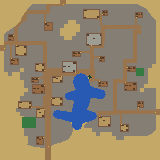
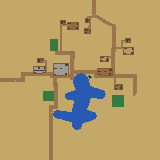
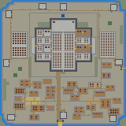

# AIMapImageGen

> [English README is here](README.md)

2D RPG 用のマップ画像を手続き的に生成するコマンドラインツールです。  
ワールドマップ・ダンジョン・洞窟・街・村・城の 6 種類のトップビューマップを出力します。

---

## 目次

1. [概要](#概要)
2. [フォルダ構成](#フォルダ構成)
3. [必要な環境](#必要な環境)
4. [ビルド方法](#ビルド方法)
5. [使い方](#使い方)
6. [バッチファイル](#バッチファイル)
7. [コードの拡張方法](#コードの拡張方法)

---

## 概要

生成できるマップの種類：

| タイプ | 説明 | 標準サイズ |
|--------|------|------------|
| `world` | フィールド（ワールドマップ） | 256×256 |
| `dungeon` | 屋内ダンジョン（部屋＋通路） | 160×160 |
| `cave` | 洞窟ダンジョン（自然な地形） | 160×160 |
| `town` | 街（入口・道路・広場・建物・公園） | 160×160 |
| `village` | 村（入り組んだ道・民家・畑・池） | 160×160 |
| `castle` | 城（堀・城壁・門・塔・本丸・内郭） | 160×160 |

各ピクセルが 1 ブロック（1 キャラ分）に対応し、バイオームごとに単色で塗り分けられます。  
出力画像を更に加工してハイトマップやテクスチャマップを生成することを想定しています。

## 出力画像例






---

## フォルダ構成

```
AIMapImageGen/
├── mapimggen.exe        ← ビルド後にここへコピーされる実行ファイル
├── bat/                 ← バッチファイル（ビルド・一括生成）
│   ├── build.bat
│   ├── generate_30_maps.bat
│   ├── generate_30_dungeon_160.bat
│   ├── generate_30_town_160.bat
│   ├── generate_30_village_160.bat
│   ├── generate_30_castle_160.bat
│   └── ...
├── build/               ← CMake ビルド出力（自動生成）
├── doc/                 ← 仕様書（生成アルゴリズムの詳細）
│   ├── mapgen_world.md
│   ├── mapgen_dungeon.md
│   └── mapgen_cave.md
│   ├── mapgen_town.md
│   ├── mapgen_village.md
│   └── mapgen_castle.md
├── sample/              ← サンプル画像
│   ├── worldmap/
│   ├── dungeon/
│   └── cave/
└── src/                 ← C++ ソースコード
    ├── CMakeLists.txt
    ├── main.cpp
    ├── MapImageGenerator.h
    ├── MapPlan.h
    ├── MapQuality.{h,cpp}
    ├── WorldMapImageGenerator.{h,cpp}
    ├── DungeonMapImageGenerator.{h,cpp}
    ├── CaveMapImageGenerator.{h,cpp}
    ├── TownMapImageGenerator.{h,cpp}
    ├── VillageMapImageGenerator.{h,cpp}
    ├── CastleMapImageGenerator.{h,cpp}
    └── utils.{h,cpp}
```

> バッチは `/bat`、ビルド成果物は `/build` に分離しています。  
> ビルド後、`bat/build.bat` が `mapimggen.exe` をルートフォルダへ自動コピーします。

---

## 必要な環境

| ソフトウェア | バージョン | 備考 |
|---|---|---|
| **Visual Studio** | 2019 以降推奨 | C++ デスクトップ開発ワークロードをインストールすること |
| **MSVC (Visual C++)** | C++17 以上 | Visual Studio に同梱 |
| **CMake** | 3.16 以上 | [cmake.org](https://cmake.org/download/) からインストール、またはVisual Studio インストーラーで追加可能 |

### インストール確認

```powershell
cmake --version
cl
```

どちらもコマンドが見つかれば準備完了です。  
`cl` が見つからない場合は「x64 Native Tools Command Prompt for VS」から実行してください。

---

## ビルド方法

### 方法 1：バッチファイルを使う（推奨）

```bat
bat\build.bat
```

このバッチが以下を自動実行します：

1. `src/` をソースとして CMake を構成（`/build` フォルダへ出力）
2. Release 構成でビルド
3. `build\Release\mapimggen.exe` をルートフォルダへコピー

### 方法 2：手動ビルド

```bat
cd src
cmake -S . -B ..\build -DCMAKE_BUILD_TYPE=Release
cmake --build ..\build --config Release
copy ..\build\Release\mapimggen.exe ..
```

---

## 使い方

```
mapimggen.exe -type <world|dungeon|cave|town|village|castle> [オプション]
```

### オプション一覧

| オプション | 説明 | デフォルト |
|---|---|---|
| `-type <world\|dungeon\|cave\|town\|village\|castle>` | マップ種別 | `world` |
| `-w <幅>` | 幅（ピクセル）。範囲: 64–1024 | world:256 / dungeon,cave,town,village,castle:160 |
| `-d <高さ>` | 高さ（ピクセル）。範囲: 64–1024 | world:256 / dungeon,cave,town,village,castle:160 |
| `-seed <数値>` | 乱数シード（再現用） | ランダム |
| `-dir <ディレクトリ>` | 出力先ディレクトリ | `.`（カレント） |
| `-out <ファイル名>` | 出力ファイル名（拡張子不要） | `out` |
| `--png` | PNG 画像を出力する | 有効 |
| `--data` | バイオーム CSV を出力する | 無効 |
| `--report` | 統計レポートを出力する | 無効 |
| `--plan` | biome配列・regions・markersをJSON出力する | 無効 |
| `--strict` | 品質検証NG時に終了コード7で失敗させる | 無効 |
| `-p <key=value>` | 詳細パラメータの個別指定 | — |

### 実行例

```bat
REM ワールドマップ（256×256、シード固定）
mapimggen.exe -type world -w 256 -d 256 -seed 12345 -dir out -out world_001 --png --report

REM ダンジョン（160×160、CSV データ付き）
mapimggen.exe -type dungeon -w 160 -d 160 -dir out -out dungeon_001 --png --data

REM 洞窟（デフォルトサイズ、PNG のみ）
mapimggen.exe -type cave -dir out -out cave_001 --png

REM 街（構造化Plan付き）
mapimggen.exe -type town -seed 12345 -dir out -out town_001 --png --report --plan

REM 村（農村型、家具region付き）
mapimggen.exe -type village -seed 12345 -dir out -out village_001 --png --report --plan --strict

REM 海岸の街 / 森の村（最新ビルドを使用）
build\Release\mapimggen.exe -type town -w 160 -d 160 -p settlementSite=1 -dir out -out coastal_town --png --plan --strict
build\Release\mapimggen.exe -type village -w 160 -d 160 -p settlementSite=3 -dir out -out forest_village --png --plan --strict

REM 城（品質NGをCIで検出）
mapimggen.exe -type castle -seed 12345 -dir out -out castle_001 --png --report --plan --strict
```

### 出力ファイル

| フラグ | ファイル名の例 | 内容 |
|---|---|---|
| `--png` | `world_001.png` | バイオーム色分け画像 |
| `--data` | `world_001.csv` | バイオーム ID の 2D 配列 |
| `--report` | `world_001_report.txt` | バイオーム統計サマリー |
| `--plan` | `world_001_plan.json` | biome配列、archetype、regions/markers、品質判定、意味リンク |

---

## バッチファイル

| ファイル | 内容 |
|---|---|
| bat/generate_30_all.bat | 6種類を各30枚、PNG/CSV/Plan/レポート付きで一括評価 |
| `bat/build.bat` | ビルドして exe をルートへコピー |
| `bat/generate_30_maps.bat` | ワールドマップ 30 枚を一括生成（256×256） |
| `bat/generate_30_maps_128.bat` | ワールドマップ 30 枚（128×128） |
| `bat/generate_30_maps_512.bat` | ワールドマップ 30 枚（512×512） |
| `bat/generate_30_dungeon_128.bat` | ダンジョン 30 枚（128×128） |
| `bat/generate_30_dungeon_160.bat` | ダンジョン 30 枚（160×160） |
| `bat/generate_30_dungeon_256.bat` | ダンジョン 30 枚（256×256） |
| `bat/generate_30_cave_160.bat` | 洞窟 30 枚（160×160） |
| `bat/generate_30_town_160.bat` | 街 30 枚（Plan/レポート付き、160×160） |
| `bat/generate_30_village_160.bat` | 村 30 枚（Plan/レポート付き、160×160） |
| `bat/generate_settlement_sites_160.bat [seed]` | 7立地の街・村を対にして生成（14枚） |
| `bat/generate_30_castle_160.bat` | 城 30 枚（品質strict、160×160） |

| スクリプト | 内容 |
|---|---|
| `tools/evaluate_town_castle.ps1` | town/village/castle の30 seed評価、全アーキタイプ評価、品質ゲート、アーキタイプ分布、seed間のPlan多様性、同一seedの再現性を確認します。 |
| `tools/evaluate_town_castle_sizes.ps1` | 64〜1024 のサイズ行列を strict 生成してサイズ適応を検査します。 |
| `tools/validate_town_castle_plan.ps1` | Plan JSON の寸法、座標、marker の region リンク、semantic role、扉/橋 tile の整合性、region の親子関係を検証します。 |

生成結果は `out/<タイムスタンプ>/` に保存されます。

---

## コードの拡張方法

### 新しいマップタイプを追加する

既存の仕様書（`doc/mapgen_world.md` → `doc/mapgen_dungeon.md` → `doc/mapgen_cave.md` → `doc/mapgen_town.md` → `doc/mapgen_castle.md`）が派生の実例です。
新しいマップタイプを追加する手順は以下の通りです。

#### 1. 仕様書を作成する

`doc/mapgen_<新タイプ>.md` を作成し、生成アルゴリズム・バイオーム・目標地形を記述します。  
既存の仕様書（特に `mapgen_dungeon.md`）を参考に、差分だけを明記すると整理しやすいです。

#### 2. GitHub Copilot でコードを生成する

仕様書が整ったら、VS Code の Copilot Chat（エージェントモード）に以下のように依頼します：

```
doc/mapgen_<新タイプ>.md の仕様に従い、
MapImageGenerator を継承した <新タイプ>MapImageGenerator クラスを
src/<新タイプ>MapImageGenerator.h と src/<新タイプ>MapImageGenerator.cpp に実装してください。
既存の DungeonMapImageGenerator を参考にしてください。
```

> 既存の仕様書と実装ファイルをコンテキストとして与えると、Copilot が構造を理解して実装を生成しやすくなります。

#### 3. 基底クラスのインターフェース

```cpp
// src/MapImageGenerator.h
class MapImageGenerator {
public:
    virtual ~MapImageGenerator() = default;
    virtual bool Generate(MapPlan& outPlan, std::string& outError) = 0;
};
```

新しいクラスはこの `Generate()` を実装するだけで `main.cpp` に組み込めます。

#### 4. main.cpp に登録する

`src/main.cpp` の生成器選択部分に新タイプを追加します：

```cpp
#include "<新タイプ>MapImageGenerator.h"

// MapTypes() に default size と factory を登録する
{"<newtype>", 160, 160, [](MapGenParams p) {
    return std::unique_ptr<MapImageGenerator>(
        std::make_unique<NewTypeMapImageGenerator>(std::move(p)));
}}
```

#### 5. CMakeLists.txt に追加する

```cmake
add_executable(mapimggen
    main.cpp
    <新タイプ>MapImageGenerator.cpp
    ...
)
```

#### 仕様書ドリブン開発のポイント

- 仕様書に「目標地形」の特徴を箇条書きで明記すると、Copilot がパラメータを適切に設定しやすくなります。
- `sample/` フォルダにサンプル画像を置いておくと、仕様書と合わせて Copilot への説明精度が上がります。
- 生成結果が期待と異なる場合は、仕様書の該当セクションを修正して再生成を依頼するイテレーションが効果的です。

---

## RPG-Cobo のアセット用下地生成

エディターの村・街・城は、`resource/map_asset.json` の名称から家、屋敷、ショップ、倉庫、アパート、教会、橋、城壁などを検索し、`bw64` を通常のアセット配置と同じ方法で復元して幅・奥行きを取得します。初期サイズは160×160ブロックです。生成候補を選択して立体プレビューを作る際、`asset_plot` に対応する家・ショップなどの建造物を自動配置します。橋・城壁は引き続き下地のみを生成します。

- 木床がアセットの正確な幅・奥行き、周囲の石床が2ブロックの余白です。屋根などを含む全体寸法を確保し、収まらないアセットは縮小しません。
- 各区画への道路は2×2ブロックを占有する人間で接続を検証します。アセットの周囲にも2ブロックの通行余地を残します。
- `Wall Height` の初期値は0です。0なら外周城壁を生成しません。正の値を明示した場合に外周城壁と城壁アセット用区画を作ります。CLIの村・街も `-p wallHeight=6` などで明示します。
- 橋は元の渡河位置で、実寸の両端が対岸に届く場合に下地を確保します。長さが足りない橋を引き伸ばすことはありません。対応アセットが収まらない古い渡河位置は水面に戻します。
- 計画JSONの `asset_plot` / `asset_bridge` / `asset_wall` の `role` が配置予定のアセットIDです。座標は画像左上原点で両端を含みます。エディターではZ方向が反転するため、区画の最小Zは `depth - 1 - y1` です。プレビュー選択時に `tmp/mapgen/last_asset_plan.json` に選択中の計画を保存します。

CLIでは `-p assetFoundation=1 -p assetCount=N` に加えて各アセットの `asset0Id`（MAの数値部分）、`asset0Width`、`asset0Depth`、`asset0Category`（0:建物、1:橋、2:城壁）を渡します。区画数の目標は `assetPlotCount`（村16、その他28）で指定できます。地形・空き面積により配置数は減ります。対象の建物が一つも収まらない場合は失敗します。`--plan --strict` で計画出力と2×2経路検証を有効にできます。

エディター連携では起動処理の引数数・長さの制限を避けるため、アセット情報をフラットな数値JSONに保存し、`--params-file <ファイル>` で渡します。`-p` と併用でき、後で指定した値を優先します。

生成UIでは建物数の目標（1〜128）、道路幅（2〜6ブロック）、地形候補数（1〜12）も調整できます。村・街では地形の向き（ランダム／0・90・180・270度）も指定できます。数値項目の上下限を同じ値にすると固定、異なる値にすると候補ごとにその範囲から選択します。道路幅は `assetRoadWidth` に対応します。建物の周囲には引き続き最低2ブロックの余白を確保します。

検証: 通常のCTestに加え、Node 24以降で `node tests/VerifyAssetFoundations.cjs <map_asset.json> <mapimggen.exe> <出力フォルダー> --village-params <last_asset_params.json>` を実行すると、エディターが記録した扉・回転情報を設定ファイル経由で渡し、村・街・城の城壁あり／なしを検証します。互換性のため引数名は `--village-params` ですが、3種類すべてで必須です。指定がなければ3種類とも明示的にスキップします。北向き建物は採用率設定に従って検証し、城の外壁なし判定では主城の壁を除外して防御マスクを確認します。

橋の区画は街の成長候補へ引き継ぎ、広場・建物・公共設備が橋とその周囲2セルを占有しないようにします。起伏・水岸調整も橋・壁の区画と周囲2セルを保護します。壁アセットの区画は成長後に予約します。城では `castleDefenseMask=2` の外周防御帯を使用し、訓練場・家具・街の装飾も避けます。予約しても既存の壁タイルは残ります。実寸で収まる位置がなければ、その壁アセットの予約は省略します。

## 村が成長する生成方式

集落の装飾は土地に合わせます。砂地・オアシスでは花を置かず、少数のサボテンと公園のヤシを使用します。森林では下草とキノコ、公園には針葉樹、水辺・海岸では草と白い花、山間では小岩を混ぜます。平地の公園には日陰になる木を置きます。道路沿いのベンチは村で最大2、街で最大4、公園にも少数配置します。立体物は全寸法と余白を確認し、道路・入口・建物に張り出さない平地だけを使います。

北向き入口の代替区画はseedと区画IDから `farm`（畑）、`park`（公園）、`vacant_lot`（空き地）に分けます。畑は土の畝を1段盛り、2マスの畝と2マスの通路を交互にし、作物用の緑の草ブロックを列状に配置します。公園は地域に合う小型樹木、ベンチ、植栽で表現します。畑や公園は新しい家を重ねない独立した区画です。Planの `settlement_prop`、`settlement_plant`、`settlement_crop` をエディターで立体化し、実際に置いた数は `last_asset_vegetation.json` に記録します。

エディターの街も村と同じ、自然地形→中心広場→大通り→中通り→実アセットと扉に合わせた区画→追加開発の方式を使います。村の家の周囲2マスは石張りにせず、草地（オアシスは砂地）の材質を保ったまま平らに整地します。整地した余白は引き続き道路や他の建物に占有させません。

街は開発可能範囲を広く取り、中心を市場広場（基準幅2で16×16、村は12×12）とします。初期目標20〜36棟、大通り2〜4本、起伏2（村は12〜24棟、1〜4本、起伏4）です。街は建物の周囲と大通りを舗装し、Paved Cityは中通りと入口への道も舗装します。他の街は中通りに土の道を残します。城壁は街の種類にかかわらず高さ0なら生成しません。街も `villageMainRoadCount` と既存の `village_center` / `village_main_road` / `village_middle_road` / `village_open_space` のPlan形式を共有します。北向き入口の空き地化、裕福度の花、起伏、水辺の侵食も共通です。

エディターの村・街・城には「裕福度」 (`countryWealth`、0.7〜2.5) を表示します。村・街では1.0未満なら花なし、1.0以上で道路脇や空き地に花を配置し、値が高いほど密度を増やします。入口、建物とその余白、道路、水辺の低い岸は装飾対象から除外します。同じseedでは高い裕福度の花の位置に低い裕福度の配置を含め、道路や建物の配置は変更しません。Planの `settlement_flower` 区画をエディターで花ブロックに変換します。城では既存の施設数・増築・舗装などを調整する値です。Castleのアセット連携では、城の内部施設を保持し、城下町の住宅に既存アセットを配置します。

村で北側（画像の上、BlockWorldの+Z）に入口が向く建物は、区画と道路への接続を残して空き地へ置き換えます。Planでは `village_open_space` / `vacant_lot` として記録し、建造物を自動配置しません。区画は整地した状態に保ちます。この置き換え分は最終的な建物数には含まれません。

村の成り立ちは「旅人や開拓者が、乾いて開けた水辺近くに荷下ろし・集会の場所を作る。外へ通う道が大通りになり、その沿道に家が建つ。家が増えると脇へ中通りが伸び、住宅地が広がる」とします。

アセット方式の村は旧方式の村配置を経由せず、まず自然地形と開発可能範囲だけを作ります。各候補は乾いた中心広場を必ず選び、中心から指定本数の大通りを外へ伸ばし、大通りから人口目標に応じて中通りを分岐させます。その道路沿いの土地を、中心近く・大通り沿いから順に開発します。目標に届かず沿道が埋まった場合は、広場や既存の道路から空き地へ中通りを追加して再配置します。建物を増やせない試行道路は取り消し、大通りの指定本数は変更しません。候補の一部では小さな建物を優先し、大きな建物だけで沿道を使い切ることを避けます。候補比較も、この最終的な建物数と中心からのまとまりを評価します。目標は配置数の保証ではなく、水域・開発可能範囲・アセット寸法と余白・入口条件によって未達になることがあります。

- 基準の道幅が2なら大通りは8、中通りは4ブロックです。一般に4倍・2倍とし、建物入口の接続は2ブロックを確保します。
- `villageMainRoadCount` は0〜4本（CLI省略値3、エディター初期値は1〜4からランダム）。0本の場合は中心から集落内の中通りだけを作り、外へ伸びる大通りは作りません。森林の外周にも出口を開けません。地形の制約で指定本数や幅が成立しない場合は失敗し、勝手に減らしません。中心は `village_center`、通りは `village_main_road` / `village_middle_road` として記録します。
- エディターはアセット内の扉フリーブロックの位置・向き・境界からの距離を調べ、90度ごとの配置候補を作ります。外向きの入口を確認できないアセットは村用の候補から除外し、ログにIDを残します。
- 建物は接する道路のうち太い通りへ扉を向け、扉の横方向のずれに合わせて区画位置を決めます。区画JSONの `rotation` はエンジンの回転、`doorX` / `doorY` は画像座標の2×2入口位置、`frontageWidth` は面する通りの幅です。`growthStage` は中心0・大通り1・大通り沿いの家2・中通り沿いの家3を表します。
- CLIで村を生成するには、各アセット候補に `Rotation`、`DoorX`、`DoorY`、`DoorSide`（画像座標で北0・東1・南2・西3）も渡します。幅・奥行きと入口は回転後・画像方向に揃えた値です。エディターで候補を選ぶと `tmp/mapgen/last_asset_params.json` に実際の数値を保存します。

検証はCTestの `village_growth` を使用します。実アセットの連携検証では `VerifyAssetFoundations.cjs` に `--village-params <last_asset_params.json>` を加え、エンジンが読み取った扉情報を使用してください。実際の扉情報がない場合は、そのスクリプトの村・街・城の連携検証を明示的にスキップします。

### 起伏・植生・道路の接続

村・街の川、湖、海の岸は、水面へ向かって土地を削ります。水際の約3マスを水面と同じ高さの低い岸辺にし、内陸へ約3マスごとに最大1段上がる形にします。隆起を0にした平地にも適用され、水面の高さは変えません。道路・橋・建物区画とその2マスの余白は削らず、その付近では削る深さを抑えます。Planの `shoreCuts` に各マスの削る段数を出力します。城の堀には自動適用しません。

村の `terrainRelief` は0〜12（エディター初期値4）。0では追加の隆起を無効にします。seedで位相の変わる広い丘を重ね、道路・広場・建物区画とその余白・水面は基準高さに整地します。周囲は保護領域から4マス離れるごとに最大1段隆起し、孤立した突起を避けます。Planの `heightOffsets` は画像座標順の高さの加算値です。現在は生活道路全体を同じ基準高さに保つため、丘の上の街路や階段道路は生成しません。

森林・オアシスの緑地は地面として描画し、森林は樹木フリーブロック、草地は草ブロックで装飾します。樹木の全幅に相当する範囲が森林であることを確認して配置し、道路・水面・建物区画への張り出しを防ぎます。オアシスでは小型のヤシを使用します。森林外周の開口部は大通りだけが作り、本数を指定した大通り数に一致させます。

川を横断する村の大通りは、両岸に道路幅全体の乾いた土地があり、24マス以内で渡れる場合に橋の通行面を生成します。橋面は両岸と同じ高さで、道路網に含めて2×2接続を検証します。橋アセットそのものの自動配置は引き続き対象外です。

エディターの初期範囲は、村の建物目標12〜24、街・城は20〜36、大通り数1〜4です。各候補で範囲から選び、左右の値を同じにすると固定値になります。CLIの `villageMainRoadCount` の省略値は引き続き3です。

## ライセンス

このプロジェクトは [MIT ライセンス](LICENSE) で公開されています。

使用・コピー・改変・再配布・商用利用など、自由に利用できます。

### 城と既存アセットの城下町

Castleの内装は `room.role` と城の種類から計画し、PNGの家具色では種類や個数を判断しません。最低4部屋の設定でも玉座・厨房・寝室を設けます。輪郭式の城の広間には宴席、山城・要塞には指揮卓と武具、川沿いには税関の窓口と荷物、宮殿にはピアノ・長椅子・燭台と家具を置かない舞踏空間を用意します。演習場は城下町の住宅より先に、城内道路に接する8〜12マス四方の用地を予約し、訓練用の人形・武具・ベンチを配置します。

`room_connection` は部屋間の接続を記録し、共有壁に幅4マス・厚さ2マスの開口と実際の室内扉を作ります。`castle_fixture` は家具、`castle_door` は部屋間の扉、`castle_surface` は赤絨毯・舞踏床・演習場の地面です。各オブジェクトは部屋の `parentIndex`、用途、ネイティブの `objectType` / `objectVariant` / `objectHeight` と回転後の実寸を保持します。生成前にエディターが実リソースの寸法を `castleObject<type>_<variant>Width/Depth/Height` として渡し、家具の移動・追加後は全室と家具のそばへ2×2で到達できることを検査します。旧来の無名の家具ブロックは、このモードでは生成しません。

内装を詰め込む前に `castle_clearance` で動線と余白を予約します。宮殿の玉座の間は最低18マスの奥行きを取り、玉座を中央軸上の定位置に置き、その前の10×8マスを謁見用に空けます。扉の周囲3マス、通常の動線4マス・広間6マスの帯には家具を置きません。扉両側の4×4マスの足場と扉間の幅4マス以上の接続も、家具を足すたびに検査します。家具を予定位置から遠くへ押し出す代わりに、収まらない任意の家具を省きます。家具の占有面積は室内の約23%（玉座の間は12%）を上限とし、家具同士にも間隔を取ります。

玉座・王室などの正式な入口には装飾付きの室内扉、生活・作業用の部屋には通常の木製扉を使います。`castle_portal` に記録する石の袖壁を前後へ1マス張り出させ、上枠と石の敷居で薄い扉を壁へつなぎます。袖壁も通行計算の障害物に含めます。赤絨毯は支持床を残し、通常のカーペットツールと同じ薄い上張りとして敷きます。

3D化後の実配置結果は `tmp/mapgen/last_castle_interior.json` に保存します。`node tests/VerifyCastleInterior.cjs <plan.json> <map_vox.json> <report.json> [last_castle_interior.json]` で、部屋用途・城の種類との対応、実リソース寸法、家具の重複、家具を考慮した2×2通行、舞踏床の空き、および実際に置かれた家具・扉を独立して照合できます。

エディターのCastleは、旧来の城郭生成（5形式、主館・内郭・塔・城壁・堀・外郭施設とその道路）をキャンバス全体に対して実行し、各タイルと区画を縦横2倍に拡大します。扉・通路も2マス以上になり、2×2の人間を基準とする城になります。さらに主館の幅・奥行きの基準を従来の2倍にし、門・水域・城下町用地を避けて収まる最大寸法と位置を選びます。隣接する部屋は境界を共有し、間仕切りは2マス厚の1本です。外周の壁も部屋の集合の外側だけに描き、部屋の大きさとともに厚くしません。主館・内郭・塔・門を保護したうえで、元の外郭施設を城下町の種として残し、その敷地を既存アセット用の住宅地へ置き換えます。城下町は元の外郭内だけで街の共通ロジックを使って成長し、城門と主館を結ぶ道路を引き継ぎます。置き換える旧施設だけへの枝道は解放し、新しい住宅の敷地を確保します。対応サイズは128×128以上、初期値160×160、Castleの城壁高さの初期値は6です。

`castle_settlement` は5形式×160/240サイズで城郭と住宅の共存・入口接続を検証します。エディターで選んだ候補は `node tests/VerifyCastleSettlement.cjs <last_asset_plan.json> <last_asset_params.json> <report.json>` で、既存アセットの回転寸法・入口と城門からの通行を確認できます。

村・街・城は共通のアセット配置規則を使います。最小の家（広い家・レンガの家1・木の家）は12×12マスなので、長辺12マス以下なら東西向きも許可し、より大きい建物は南北向きだけにします。`northFacingHouseKeepPercent` は北向きの家を残す確率（0〜100、初期値10）、`sideFacingHouseKeepPercent` は小型の家の東西向きを残す確率（0〜100、初期値75）です。両方ともエディターのプロパティで設定できます。残さない区画は畑・公園・空き地とし、建物目標数には数えません（代替区画は目標の約1/4まで）。向きの抽選はseedと道路の位置から決まり、別アセットの試行や道路の巻き戻しで引き直しません。

アセット名から教会・神殿・寺院を礼拝施設グループ、城・宮殿を王侯の居館グループにまとめ、それぞれ1マップ1棟までに制限します。回転違いや別IDにも同じ制限が掛かります。Castleは生成済みの主館を王侯の居館として数えます。CLIのアセット情報は `assetNLimitGroup` と `assetNMaxCount` でこの制限を伝えます。家・店・倉庫・アパートは個数制限を設けません。

エディターの村・街・城は共通の中心設備計画（`settlementCivicPlan=1`）を使います。中心広場に接続する用地を住宅より先に予約し、裕福度0.7以上で共同井戸、1.0以上でベンチ、1.5以上で街灯、2.0以上で露店と彫像を追加します。`settlement_facility` の用途・実モデル寸法・回転・中心広場への親参照と、`settlement_facility_access` に接続点を記録します。接続点は中心から24マス以内とし、広場の交差点や道路上には設備を置きません。村は整地、街・城下町は街の地面表現を引き継ぎ、設備の用地は起伏・水辺の侵食・草木の追加から保護します。

裕福度2.0以上では、南向きの住宅アセットを中心近くに1棟確保し、村長宅とします。名称から住宅を `assetNResidential` で識別し、長辺12マスを超えるものから、まず「大きな屋敷」（26×17マス）など面積の大きい家を試します。敷地に収まらなければ次の大きな住宅を試し、店・倉庫・教会・城を村長宅には使いません。村長宅は建物目標数に含み、`residentProfile=village_head`、`livingArrangement=mayors_residence`、`settlement_mayor` の入口マーカーで識別します。入口の接続点は中心から32マス以内です。必要な用地が確保できない生成候補は採用しません。CLIでこの計画を使う場合も、住宅の分類・扉の位置・実寸を渡してください。

中心設備の実配置は `tmp/mapgen/last_settlement_civic.json` に保存します。`node tests/VerifySettlementCivic.cjs <plan.json> <params.json> <map_vox.json> <report.json> [last_settlement_civic.json]` で裕福度の段階、村長宅の一意性・向き・近さ、設備の実寸、家具・建物・設備を避けた2×2通行、およびエディターに置かれた設備を照合できます。

城の主館外殻は外郭と同じ石造りブロックを使います。正面に幅10×高さ7マスの既存の城門（`FB_EXDOOR` variant 16）を解錠状態で配置し、`castle_front_door` 領域として幅10×奥行2マスの開口を確保します。配置確認は `tmp/mapgen/last_castle_doors.json` に保存します。城下町の開発可能範囲から追加の外壁は作らず、城本来の外郭生成だけが防御力設定に応じた連続した城壁を担当します。

Castleは「地形の候補数」の範囲で城郭と城下町を一緒に試作し、2×2で城門・主館・各入口へ接続できる候補から実際の住宅数が最も多いものを選びます。同数なら城郭の評価で選びます。城の形式・裕福度・防御力は試作間で固定します。`castleHistory` の `layout_selection` と `layout_trial` に採用候補と各候補の住宅数を記録します。`node tests/VerifySettlementFrontage.cjs <plan.json> <params.json> <report.json>` は3種類共通で、正面向き、実アセットの寸法・扉位置、敷地重なり、2×2通行、城の候補選択を確認します。

CastleのUIはサイズの直下に「城の種類」を表示し、ランダム・輪郭式の城・山城・川沿いの城・宮殿・要塞を選択できます。外郭防御力（0.5未満は開放、1.5以上は堀付き）、主館の幅・奥行きの基準割合、門・塔・主館の部屋・城内施設の数、施設密度、堀幅、壁厚、大通り幅、道の追加接続率、舗装も指定できます。主館の基準割合は2倍にして生成し、土地に収まらない場合は縮小します。城下町に置き換える旧施設数は、拡大した主館の周囲に収まる数までになります。数と堀幅の範囲は生成器の `Min` / `Max` に渡します。`castle_settlement` では主館寸法の倍増、共有壁の厚さ、全室への2×2通行、主館のタイルが住宅配置で壊れないこと、住宅と余白が元の外郭内に収まることを検証します。
